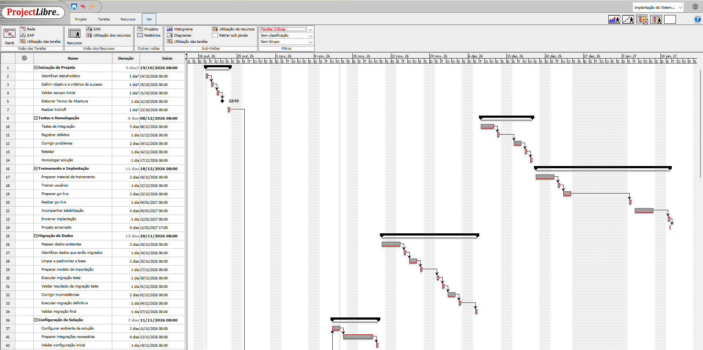
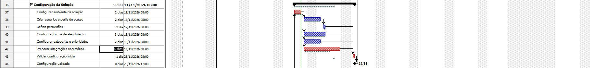

# 📅 Cronograma no ProjectLibre

O cronograma do projeto **Implantação do Sistema de Atendimento** também foi estruturado no **ProjectLibre** com o objetivo de aprofundar a prática de planejamento preditivo e gerenciamento de cronogramas.

Durante o desenvolvimento, foram aplicados conceitos utilizados em ferramentas tradicionais de gestão de projetos, incluindo:

- Gráfico de Gantt
- Tarefas-resumo e subtarefas
- Predecessoras e dependências
- Atividades executadas em paralelo
- Marcos / Milestones
- Calendário de trabalho
- Caminho crítico
- Linha de base / Baseline
- Análise de impacto de atrasos

---

## 📊 Gráfico de Gantt

O cronograma foi estruturado considerando as principais fases do projeto, desde a iniciação até o encerramento da implantação.

O planejamento contempla atividades sequenciais e paralelas, permitindo visualizar dependências e impactos entre as diferentes etapas do projeto.

---

## 🔗 Dependências e Caminho Crítico

As dependências foram configuradas por meio de predecessoras, permitindo que o cronograma fosse recalculado automaticamente conforme a duração e sequência das atividades.

Também foi utilizado o recurso de **Caminho Crítico**, identificando as atividades com folga zero e que poderiam impactar diretamente a data final do projeto em caso de atraso.

No projeto, por exemplo, determinadas atividades de integração e testes fazem parte do caminho crítico por determinarem o início das etapas seguintes.

---

## ♦️ Marcos do Projeto

Foram utilizados marcos com duração de **0 dias** para representar acontecimentos importantes do projeto, como:

- Termo de Abertura aprovado
- Solução selecionada
- Configuração validada
- Migração concluída
- Homologação concluída
- Go-live realizado
- Projeto encerrado

Os marcos permitem acompanhar pontos importantes do projeto sem representar atividades que consomem tempo de execução.

---

## 📉 Baseline e Simulação de Desvio

Após a conclusão do planejamento inicial, foi salva uma **linha de base (Baseline)** para registrar o cronograma originalmente planejado.

Em seguida, foi realizada uma simulação aumentando a duração da atividade **Preparar integrações necessárias** de 4 para 6 dias.

A simulação permitiu observar:

- diferença entre o planejamento original e o cronograma atualizado;
- impacto do atraso nas atividades seguintes;
- alteração da data de validação da configuração;
- propagação do atraso em uma atividade pertencente ao caminho crítico.

Após a análise, a duração foi restaurada para o valor originalmente planejado.

---

## 🎯 Competências praticadas

Com esta etapa do projeto, foram praticados conceitos de gerenciamento de cronograma como:

`Gantt` • `Dependências` • `Predecessoras` • `Milestones` • `Caminho Crítico` • `Baseline` • `Calendário de Projeto` • `Análise de Impacto`

